# Product Requirements Document (PRD)
## Otomatisasi Internet of Things (IoT) pada Sistem Pemberi Pakan Ikan Aquaponik

> **Status dokumen (2026-10-06):** Tahap 1 (infrastruktur MQTT + simulator) dan sebagian besar
> Tahap 2 (dashboard web + database) **sudah berjalan** — broker MQTT tertanam, worker ingesti,
> SQLite, dan dashboard Streamlit aktif dalam satu proses Python (`dashboard/`). Yang belum:
> firmware ESP32 fisik dan perakitan prototipe akuaponik.
>
> **Dokumen ini adalah satu-satunya sumber acuan (single source of truth).** Seluruh isi
> `DEVICE_PROTOCOL.md`, `DATABASE_PLAN.md`, `DASHBOARD_FLOWCHART.md`, `FLOWCHART_PER_INSTANCE.md`,
> `STARTUP_GUIDE.md`, dan `CHEATSHEET.md` sudah disatukan ke dalam PRD ini (Bagian B–E).
> Berkas-berkas lama tetap ada sebagai arsip/referensi tambahan.

**Daftar Isi**
- **A. Requirements** — §1 Meta · §2 Masalah & Solusi · §3 Scope · §4 Arsitektur · §5 Fitur (FR) · §6 Data & Protokol · §7 Alur & State · §8 Skenario · §9 Non-Fungsional (NFR)
- **B. Design Detail** — §10 Protokol Device · §11 Desain Database
- **C. Flows & Diagrams** — §12 Flowchart per Instance · §13 Skenario (Web → MQTT → DB)
- **D. Traceability & Testing** — §14 Kriteria Penerimaan · §15 Matriks Traceability
- **E. Proyek** — §16 Timeline · §17 Asumsi · §18 Risiko · §19 Operasional · §20 Glossary

---

# BAGIAN A — REQUIREMENTS

## 1. META INFORMATION
- **Project Name:** Rancang Bangun Sistem Monitoring dan Pemberi Pakan Ikan Otomatis pada Aquaponik Menggunakan ESP32 Berbasis IoT
- **Platform:** Web-based Dashboard (Streamlit) & IoT Hardware
- **Core Technologies:** ESP32 (target), MQTT (broker tertanam **amqtt**; Mosquitto opsional), SQLite (tertanam), Python (broker + worker + dashboard), Streamlit, JavaScript (`sim.js` simulator)
- **Target Users:** Pemilik sistem akuaponik/aquarium yang membutuhkan pemantauan dan kontrol pakan jarak jauh.
  - **Persona utama:** pemilik kolam/akuarium rumahan dengan sedikit waktu, ingin pakan terjadwal tanpa harus hadir.
  - **Kebutuhan inti:** tahu sisa pakan tanpa melihat langsung, bisa memberi pakan darurat dari jarak jauh, menerima peringatan saat pakan habis atau perangkat mati.

---

## 2. PROBLEM STATEMENT & SOLUTION
### 2.1 Problems
- **Tantangan Pakan Manual:** Pemberian pakan manual sering tidak tepat waktu dan kuantitas. Pakan berlebih memicu amonia (merusak air), pakan kurang menghambat pertumbuhan ikan.
- **Keterbatasan Pemantauan:** Dibutuhkan sistem yang dapat dipantau dan dikontrol secara jarak jauh (*remote*) secara *real-time*.

### 2.2 Solution
- Membangun otomatisasi berbasis IoT menggunakan mikrokontroler **ESP32** terintegrasi dengan protokol **MQTT** (Publish-Subscribe) yang ringan dan responsif.
- Menyediakan Web Dashboard sentral untuk memantau sisa pakan, mengatur jadwal, memberi pakan manual, dan melihat riwayat secara *real-time*.

---

## 3. SCOPE & CONSTRAINTS (BATASAN MASALAH)
- **In-Scope (Termasuk):**
  - Penambahan mikrokontroler **ESP32** untuk mengendalikan sensor ultrasonik (level pakan) dan motor servo.
  - Penggunaan protokol komunikasi MQTT dan basis data SQLite (keduanya **tertanam di dalam proses aplikasi**).
  - Pembuatan Web Dashboard untuk: monitoring sisa pakan, notifikasi, kontrol jadwal, pakan manual, dan histori.
  - Implementasi pada prototipe wadah akuaponik sebagai objek uji coba teknis.
- **Out-of-Scope (Tidak Termasuk):**
  - Penelitian terhadap parameter biologis tanaman.
  - Penelitian terhadap tingkat kesehatan ikan.
  - **Keamanan produksi:** autentikasi/TLS pada broker MQTT, multi-user & hak akses, serta deployment cloud (lihat NFR-05).
  - Dukungan multi-device yang teruji (sistem saat ini berjalan untuk 1 device, lihat NFR-06).

---

## 4. SYSTEM ARCHITECTURE
Arsitektur menggunakan pola aliran data *Event-Driven* dua arah melalui MQTT. **Seluruh komponen (broker, worker ingesti, sweeper, database, dashboard) berjalan di dalam satu proses Python** (`dashboard/run.py`).

### 4.1 Block Diagram Flow
1. **Device Level:** ESP32 (target) ATAU `sim.js` (simulator, Node v22). Node-RED (`flows.json`) tersedia sebagai simulator alternatif/legacy.
2. **Communication Layer:** Broker MQTT (`:1883`) — **tertanam (amqtt)**, atau memakai Mosquitto yang sudah jalan jika port 1883 terpakai. Berkomunikasi dua arah (<->) dengan Device.
3. **Logic Layer:**
   - **Worker ingesti** (`mqtt.py` + `handlers.py`) — subscribe `feeder/+/telemetry|ack|status`, menulis ke DB, mengevaluasi alert.
   - **Sweeper** (tiap 10 s) — menandai command yang tidak di-ACK sebagai `timeout`.
   - **Commands** (`commands.py`) — menyimpan command lalu publish ke device.
4. **Data Storage:** **SQLite** (`dashboard/feeder.db`, mode WAL) — dibaca/ditulis langsung oleh worker dan UI.
5. **Presentation Layer:** **Streamlit** (`app.py`, `:8501`) membaca DB dan mengirim perintah melalui worker.

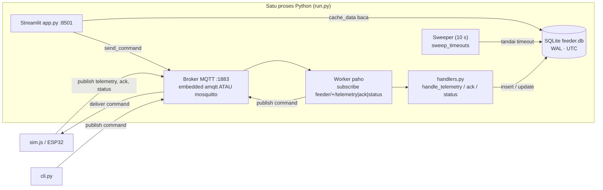

### 4.2 Hardware Components
- Mikrokontroler: ESP32
- Sensor: Sensor Ultrasonik (Pengukur jarak ke permukaan pakan → dikonversi ke level/sisa pakan)
- Aktuator: Motor Servo (Membuka/menutup katup pakan)

### 4.3 Runtime Components (`dashboard/`)
| Berkas | Peran |
|---|---|
| `run.py` | Entry point: init DB → start broker → start worker → start sweeper → jalankan Streamlit |
| `broker.py` | Broker MQTT tertanam (amqtt) atau deteksi broker eksternal |
| `mqtt.py` | Worker paho: subscribe `feeder/+/telemetry`, `ack`, `status`; buffer tail untuk tab Live |
| `handlers.py` | `handle_telemetry` / `handle_ack` / `handle_status`, evaluasi alert |
| `commands.py` | `send_command()`: INSERT `commands` (+ `feeding_logs`) lalu publish; `apply_ack()` |
| `db.py` | Akses SQLite (thread-local, WAL, `BEGIN IMMEDIATE`) + view + query |
| `cli.py` | Kirim command tanpa dashboard (butuh app jalan) |
| `app.py` | UI Streamlit (6 tab) |
| `config.py` | Konfigurasi (port, path DB, timeout, topik) |

---

## 5. FUNCTIONAL REQUIREMENTS (FITUR)

### 5.1 Kategori Fitur (Dashboard Web Streamlit)
Web Dashboard dibagi menjadi beberapa tab/halaman utama:

#### A. Status / Live
- **FR-01 Grafik Sensor Periodik:** Menampilkan persentase sisa pakan dari waktu ke waktu (tab Live), rentang 1/6/24 jam.
- **FR-02 Tampilan Data Terakhir:** Menampilkan status terkini perangkat (Jarak sensor, Sisa pakan, State, Online) dengan auto-refresh tiap **2 detik**.

#### B. Kontrol
- **FR-03 Pemberian Pakan Manual:** Tombol untuk mengeksekusi pemberian pakan saat itu juga — mengirim **command MQTT `type: "manual_feed"`** dengan `payload: {"portions": N}` (fungsi `startFeed(portions)` dieksekusi di sisi device).
- **FR-04 Cek Status Pakan:** Mengirim command `get_state` untuk meminta pembaruan status alat terkini.
- **FR-05 Pengaturan Waktu & Penjadwalan (Schedules):** Lihat, tambah, atau ubah jadwal pemberian pakan otomatis. Jadwal disimpan lokal di DB, lalu dikirim ke device via command `set_schedule`.
- **FR-06 Pengaturan Threshold:** Mengatur batas persentase sisa pakan untuk memicu notifikasi (mengubah DB **dan** mengirim command `set_threshold`).

#### C. Alerts (Notifikasi)
- **FR-07 Notifikasi:** Menampilkan peringatan berdasarkan status pakan:
  - `feed_low` — Pakan hampir habis.
  - `feed_empty` — Pakan habis.
  - `feed_failed` — Pemberian pakan gagal.
  - `device_offline` — Perangkat *offline* (berdasarkan *Last Will and Testament* / LWT dari MQTT).
  - Tersedia aksi "Baca" per notifikasi dan "Tandai semua dibaca".

#### D. History (Riwayat)
- **FR-08 Tabel Riwayat:** Mencatat setiap kejadian pemberian pakan (waktu, trigger, jadwal, porsi, status, level sebelum/sesudah) beserta ringkasan sukses/gagal, untuk periode 1/7/30 hari.
  > Catatan: visualisasi tren historis sudah tercakup di tab **Live** (FR-01); tab History fokus pada tabel rincian.

### 5.2 Tabel Fitur per Tab
| Tab | Fitur | FR |
|---|---|---|
| Status | Sisa pakan · Jarak sensor · State · Online · badge alert (habis/menipis/sehat) | FR-02 |
| Live | Grafik telemetry 1/6/24 jam · 200 pesan MQTT terakhir | FR-01 |
| Alerts | feed_low · feed_empty · feed_failed · device_offline · tandai dibaca | FR-07 |
| History | Riwayat pakan 1/7/30 hari · level sebelum/sesudah · ringkasan sukses/gagal | FR-08 |
| Schedules | Lihat/tambah jadwal · aktif–nonaktif · kirim `set_schedule` | FR-05 |
| Control | `manual_feed` · `get_state` · `set_threshold` · `set_rtc` | FR-03/04/06 |

---

## 6. DATA & PROTOCOL MODELS

### 6.1 MQTT Topic Structure
Semua topik memakai format `feeder/<device_id>/<jenis>` (`feeder01` = device_id):

| Topik | Arah | Isi / Payload |
|---|---|---|
| `feeder/<device_id>/status` | device → platform | `online` / `offline` (string, **retained**; LWT saat device mati) |
| `feeder/<device_id>/telemetry` | device → platform | JSON: `{device, state, distance_cm, ts}` |
| `feeder/<device_id>/state` | device → platform | Snapshot state lengkap (jadwal, RTC, level pakan) |
| `feeder/<device_id>/command` | platform → device | JSON: `{command_id, type, payload, timestamp}` |
| `feeder/<device_id>/ack` | device → platform | JSON: `{command_id, result, message, ts}` — **wajib** untuk setiap command |

- **Telemetry payload (target):** `{"device": "feeder01", "state": "idle", "distance_cm": 12.5, "ts": "2026-10-02T13:38:14Z"}`
  - Persen sisa pakan dihitung **aplikasi** dari kalibrasi: `pct = (empty_cm − distance_cm) / (empty_cm − full_cm) × 100` (dibatasi 0–100). Aplikasi juga menerima `feed_level_pct` / `level` dari device bila firmware menghitung sendiri.
- **Command types:** `manual_feed`, `set_schedule`, `set_threshold`, `set_rtc`, `get_state`.
- **Korelasi:** `command_id` di-echo persis di `ack`; tanpa ack dalam 30 detik → `timeout`.
- Rincian lengkap kontrak device ada di **§10 Protokol Device**.

### 6.2 SQLite Database Tables (ringkas)
- `commands`: log perintah keluar + korelasi ack (`pending → sent → success/failed/timeout`).
- `devices`: status perangkat (online/offline) + kalibrasi sensor & threshold.
- `feeding_logs`: *history* pemberian pakan, porsi, waktu eksekusi.
- `notifications`: log peringatan (habis, menipis, gagal, offline).
- `schedules`: jam + porsi penjadwalan otomatis (berlaku tiap hari).
- `telemetry`: *time-series* jarak/persentase sisa pakan.
- **View `v_device_status`**: gabungan device + telemetry terbaru + flag `is_low`/`is_empty`.
- Skema kolom lengkap ada di **§11 Desain Database**.

---

## 7. SYSTEM FLOW & STATE MACHINE

### 7.1 Hardware Flowchart (ESP32 Loop)
1. Inisialisasi WiFi & MQTT Server (Set LWT `offline` ke `feeder/<device_id>/status`, retain).
2. Publish status `online` (retain), Subscribe ke `feeder/<device_id>/command`.
3. Masuk ke Non-blocking Loop (menggunakan `millis()`, tanpa `delay()`).
4. Cek jadwal lokal (`checkLocalSchedule()`) & eksekusi gerakan servo (`advanceServoStep()`).
5. Jika ada pesan MQTT masuk di topik command, cek `type`:
   - Jika `manual_feed` -> jalankan `startFeed(portions)` secara non-blocking.
   - Jika `set_schedule`, `set_threshold`, `set_rtc` -> simpan konfigurasi.
   - Jika `get_state` -> susun state lengkap.
   - Publish ACK (Acknowledgment) dengan `command_id` dan `result` — **untuk semua tipe, sukses maupun gagal**.
6. Jika masuk periode pengiriman data sensor -> publish telemetry `{device, state, distance_cm}`.
7. Ulangi loop selama terhubung. Jika putus, broker menerbitkan LWT `offline`.

### 7.2 Website Flowchart (Streamlit)
1. Muat Antarmuka (Sidebar: pilih device, status broker/worker/DB, tombol "Muat ulang data").
2. Tampilkan semua data terkait perangkat (Read DB, cache 2 s).
3. Evaluasi interaksi pengguna:
   - Jika tombol 'Muat ulang data' diklik -> kosongkan cache + tarik ulang data dari DB.
4. Render Tab yang dipilih oleh pengguna: Status, Live, Alerts, History, Schedules, atau Control.

---

## 8. SKENARIO PENGGUNA (RINGKAS)
Daftar skenario utama (diagram lengkap di **§13**):

| Kode | Skenario | Instance terlibat |
|---|---|---|
| S1 | Buka dashboard & pilih device (read-only) | Web, DB |
| S2 | Monitor Status (auto-refresh 2 s) | Web, DB |
| S3 | Monitor Live (grafik + pesan MQTT) | Web, DB, Worker |
| S4 | Alerts — baca / tandai dibaca | Web, DB |
| S5 | History pemberian pakan | Web, DB |
| S6 | Schedules — tambah & aktif/nonaktif (lokal) | Web, DB |
| S7 | Schedules — kirim `set_schedule` ke device | Web, MQTT, DB, HW |
| S8 | Control — pakan manual sukses | Web, MQTT, DB, HW |
| S9 | Control — pakan manual gagal (ack error) | Web, MQTT, DB, HW |
| S10 | Control — pakan manual timeout (tanpa ack) | Web, MQTT, DB, HW |
| S11 | Control — `set_threshold` | Web, MQTT, DB, HW |
| S12 | Control — `get_state` | Web, MQTT, DB, HW |
| S13 | Control — `set_rtc` | Web, MQTT, DB, HW |
| S14 | Device online (birth) | MQTT, Worker, DB |
| S15 | Device offline (LWT) | MQTT, Worker, DB |
| S16 | Telemetry — alert level menipis/habis | MQTT, Worker, DB |
| S17 | Muat ulang data (clear cache) | Web, DB |

---

## 9. NON-FUNCTIONAL REQUIREMENTS & METRICS
Pengujian dan analisis didasarkan pada parameter teknis IT. Target di bawah adalah ambang uji yang disepakati:

1. **NFR-01 Keandalan Infrastruktur:** transmisi data alat fisik/simulator → MQTT → Database → Web berjalan tanpa kehilangan pesan; telemetry tiap 10–30 s; UI auto-refresh 2 s; reconnect otomatis.
2. **NFR-02 Latensi Perintah:** round-trip perintah manual feed (web → ack device) **≤ 2 detik** pada jaringan lokal; command tanpa ack ditandai `timeout` setelah **30 detik** (sweep tiap 10 s).
3. **NFR-03 Akurasi Sensor:** deviasi persentase sisa pakan hasil konversi terhadap pengukuran manual **≤ 5%**.
4. **NFR-04 Akurasi Penjadwalan:** eksekusi jadwal menyimpang **≤ 60 detik** dari jam terjadwal.
5. **NFR-05 Keamanan (constraint):** broker MQTT berjalan tanpa autentikasi dan tanpa TLS — hanya untuk jaringan lokal, bukan deployment publik.
6. **NFR-06 Skala (constraint):** sistem divalidasi untuk **1 device** (`feeder01`); multi-device belum diuji.

---

# BAGIAN B — DESIGN DETAIL

## 10. PROTOKOL DEVICE (Kontrak MQTT untuk Firmware ESP32)
> Bagian ini = "apa yang harus dilakukan device". Sudah tervalidasi E2E dengan `sim.js` + aplikasi (broker MQTT tertanam + database SQLite).

### 10.1 Koneksi
| Parameter | Nilai | Catatan |
|---|---|---|
| Broker | `mqtt://<IP-Mac-anda>:1883` | Broker MQTT di dalam aplikasi (default port `1883`) |
| ClientId | `feeder01` | **Harus unik & stabil** — jangan dipakai 2 proses (bug nyata: sesi saling tendang) |
| Keepalive | 60 s | |
| LWT (Will) | topic `feeder/feeder01/status`, payload `offline`, **retain=true** | Otomatis terpublish broker saat device mati |
| Saat connect | publish `online` ke `feeder/feeder01/status`, **retain=true** (birth) | Lalu subscribe command |

**Publish oleh device (3 topic):**

| Topic | Kapan | Format |
|---|---|---|
| `feeder/feeder01/status` | connect (birth) + LWT | string `online` / `offline` (bukan JSON) |
| `feeder/feeder01/telemetry` | periodik 10–30 s | JSON (lihat §10.2) |
| `feeder/feeder01/ack` | **wajib** balas tiap command | JSON (lihat §10.4) |

**Subscribe oleh device (1 topic):**

| Topic | Isi |
|---|---|
| `feeder/feeder01/command` | JSON perintah dari platform/dashboard (lihat §10.3) |

> **Penting — filter berdasarkan topic.** Firmware **wajib mengabaikan setiap pesan yang topic-nya bukan `feeder/<device>/command`**, jangan menganggap semua pesan masuk sebagai perintah. Broker tertanam (amqtt) punya perilaku non-standar: pesan *retained* (mis. `status` `online`/`offline`) bisa ikut terkirim ke subscriber apa pun tanpa memedulikan filter topic. Filter di sisi device membuat perilaku broker itu tidak berbahaya.

### 10.2 Payload Telemetry (device → platform)
Format target firmware (jarak mentah dari sensor ultrasonik — aplikasi yang menghitung persen dari kalibrasi di database):

```json
{
  "device": "feeder01",
  "state": "idle",
  "distance_cm": 12.5,
  "ts": "2026-09-23T13:00:00Z"
}
```

| Field | Wajib | Keterangan |
|---|---|---|
| `device` | ya | device_code (harus sama dengan clientId) |
| `state` | ya | `idle` / `feeding` / `error` |
| `distance_cm` | target utama | jarak sensor ke permukaan pakan (cm). Persen dihitung aplikasi: `(empty_cm − distance) / (empty_cm − full_cm) × 100` |
| `feed_level_pct` | alternatif | boleh menggantikan `distance_cm` jika firmware sudah hitung sendiri persen |
| `ts` | opsional | ISO-8601; DB pakai waktu terima jika tidak ada |

Aplikasi juga menerima format lama `{ "level": 50 }` (Node-RED) — kompatibel.

### 10.3 Payload Command (platform → device, device SUBSCRIBE)
```json
{
  "command_id": "cmd-ed239f2b-f305-46e6-8998-4fa7a4492986",
  "type": "manual_feed",
  "payload": { "portions": 2 },
  "timestamp": "2026-09-23T13:50:18Z"
}
```

| `type` | `payload` | Aksi device |
|---|---|---|
| `manual_feed` | `{ "portions": 2 }` | Jalankan servo × porsi, lalu ACK |
| `set_schedule` | `{ "schedules": [ { "id": 1, "feed_time": "07:00:00", "portions": 2 } ] }` | Simpan ke NVS/RTC, ACK |
| `set_threshold` | `{ "threshold_pct": 25 }` | Simpan, ACK |
| `set_rtc` | `{ "datetime": "2026-09-23T13:00:00" }` | Set RTC internal, ACK |
| `get_state` | `{}` | Balas state lengkap via ACK |

### 10.4 Payload Ack (device → platform, WAJIB untuk setiap command)
```json
{
  "command_id": "cmd-ed239f2b-f305-46e6-8998-4fa7a4492986",
  "result": "ok",
  "message": "feeding 2 portions",
  "ts": "2026-09-23T13:50:19Z"
}
```

Aturan:
- **`command_id` di-echo sama persis** — ini kunci korelasi di database.
- `result`: `"ok"` = sukses; nilai lain (`"error_low_level"`, `"error_servo"`, dst) = gagal → aplikasi mencatat `failed` + membuat notifikasi `feed_failed`.
- **Tanpa ack dalam 30 detik** → aplikasi menandai command `timeout` dan feeding_log `failed` (sudah otomatis).
- Ack dikirim meskipun perintah gagal dieksekusi (result error), bukan diam.

### 10.5 Checklist Firmware ESP32
- [ ] ClientId unik + stabil (`feeder01`)
- [ ] Birth `online` (retain) + LWT `offline` (retain) di topic `status`
- [ ] Subscribe `feeder/feeder01/command`
- [ ] **Abaikan pesan yang topic-nya bukan `feeder/feeder01/command`** (lihat catatan §10.1)
- [ ] Publish telemetry periodik dengan `distance_cm`
- [ ] **Echo `command_id`** di setiap ack, kirim untuk sukses MAUPUN gagal
- [ ] State `feeding` saat motor jalan
- [ ] Reconnect otomatis + publish birth ulang saat sambungan kembali

---

## 11. DESAIN DATABASE — SQLite (feeder_db)

> **Engine: SQLite**, berjalan **di dalam proses aplikasi** (`dashboard/run.py`). Tidak ada server MySQL terpisah. Definisi lengkap + seed: `database/schema.sql`.

### 11.1 Keputusan Desain
| Aspek | Keputusan |
|---|---|
| Engine | **SQLite** (bawaan Python, tanpa server) — file `dashboard/feeder.db` |
| Kenapa bukan MySQL | MySQL tidak bisa di-embed di proses aplikasi (`libmysqld` dihapus sejak MySQL 8.0), jadi dia harus jadi service terpisah. SQLite bisa jalan di dalam aplikasi. |
| Pengukuran pakan | **Jarak sensor ultrasonik ke permukaan pakan (cm)** — disimpan mentah di `telemetry.distance_cm` |
| Konversi ke persen | `pct = (empty_cm − distance_cm) / (empty_cm − full_cm) × 100`, dibatasi 0–100; kalibrasi di `devices.sensor_full_cm` & `devices.sensor_empty_cm` |
| Satuan porsi | `portions` (jumlah porsi), konsisten dengan payload `manual_feed` MQTT |
| Jadwal | **Berlaku setiap hari** (tanpa kolom hari) — cukup `feed_time` + `portions` + `is_active` |
| Waktu | TEXT ISO `YYYY-MM-DD HH:MM:SS.SSS` (presisi milidetik, menggantikan `DATETIME(3)`) |
| Enum | `ENUM(...)` MySQL → `TEXT` + `CHECK (kolom IN (...))` |
| JSON | `JSON` MySQL → `TEXT` + `CHECK (json_valid(kolom))` |
| Konkurensi | `PRAGMA journal_mode=WAL`, `busy_timeout=5000`, `foreign_keys=ON` (default SQLite: OFF) |
| Transaksi | Operasi multi-statement (pakan manual, ack, sweep timeout) pakai `BEGIN IMMEDIATE` |

### 11.2 Skema — 6 Tabel

**`devices`** — perangkat + konfigurasi (FR-02 & FR-07)
| Kolom | Tipe | Keterangan |
|---|---|---|
| `id` | INTEGER PK AI | |
| `device_code` | TEXT UNIQUE | Kode unik = bagian topik MQTT (mis. `feeder01`) |
| `name` | TEXT | Nama tampilan |
| `location` | TEXT NULL | Lokasi penempatan |
| `sensor_full_cm` | REAL | Jarak sensor saat hopper **penuh** (kalibrasi) |
| `sensor_empty_cm` | REAL | Jarak sensor saat hopper **kosong** (kalibrasi) |
| `low_feed_threshold_pct` | INTEGER | **Ambang notifikasi pakan menipis (%)** — default 20 |
| `is_online` | INTEGER 0/1 | Dari topik `status` (LWT/birth) |
| `last_seen_at` | TEXT NULL | Terakhir telemetry/status diterima |
| `created_at` / `updated_at` | TEXT | Diisi kode (SQLite tidak punya `ON UPDATE`) |
Constraint: `CHECK (sensor_full_cm < sensor_empty_cm)`.

**`telemetry`** — time-series level pakan (FR-01)
| Kolom | Tipe | Keterangan |
|---|---|---|
| `id` | INTEGER PK AI | |
| `device_id` | FK → devices | ON DELETE CASCADE |
| `distance_cm` | REAL NULL | **Raw jarak ultrasonik** dari MQTT |
| `feed_level_pct` | REAL NULL | Persen sisa pakan (dari device atau konversi aplikasi) |
| `state` | TEXT NULL | `idle` / `feeding` / `error` |
| `recorded_at` | TEXT | Waktu masuk (default `strftime(...)`) |
Index: `(device_id, recorded_at)`.

**`schedules`** — jadwal pakan, berlaku tiap hari (FR-05)
| Kolom | Tipe | Keterangan |
|---|---|---|
| `id` | INTEGER PK AI | |
| `device_id` | FK → devices | |
| `name` | TEXT | Mis. "Pakan Pagi" |
| `feed_time` | TEXT | Jam pemberian, `'07:00:00'` |
| `portions` | INTEGER | Porsi per eksekusi, default 1 |
| `is_active` | INTEGER 0/1 | Aktif/nonaktif |
| `created_at` / `updated_at` | TEXT | |
Index: `(device_id, is_active, feed_time)`.

**`commands`** — log perintah MQTT keluar (FR-03/04/05/06, korelasi ack)
| Kolom | Tipe | Keterangan |
|---|---|---|
| `id` | INTEGER PK AI | |
| `command_id` | TEXT UNIQUE | ID dari payload JSON (korelasi dengan `ack`) |
| `device_id` | FK → devices | |
| `type` | TEXT + CHECK | `manual_feed`, `set_schedule`, `set_threshold`, `set_rtc`, `get_state` |
| `payload` | TEXT + `json_valid` | Payload perintah apa adanya |
| `status` | TEXT + CHECK | `pending` → `sent` → `success` / `failed` / `timeout` |
| `result_message` | TEXT NULL | Pesan `message` dari ack |
| `created_at` | TEXT | |
| `acked_at` | TEXT NULL | Diisi saat ack diterima |
Index: `(device_id, created_at)`.

**`feeding_logs`** — history pemberian pakan (FR-08)
| Kolom | Tipe | Keterangan |
|---|---|---|
| `id` | INTEGER PK AI | |
| `device_id` | FK → devices | |
| `command_id` | TEXT NULL | Korelasi commands/ack; NULL jika device eksekusi jadwal mandiri |
| `trigger_type` | TEXT + CHECK | `manual` / `scheduled` |
| `schedule_id` | FK → schedules NULL | Diisi jika trigger = `scheduled` |
| `portions` | INTEGER | Porsi yang diberikan |
| `status` | TEXT + CHECK | `pending` / `success` / `failed` |
| `message` | TEXT NULL | Pesan ack dari device |
| `distance_before_cm` / `distance_after_cm` | REAL NULL | Jarak sensor sebelum/sesudah |
| `feed_level_before_pct` / `feed_level_after_pct` | REAL NULL | Persen sebelum/sesudah |
| `requested_at` | TEXT | Waktu perintah/jadwal |
| `completed_at` | TEXT NULL | Diisi saat selesai (ack) |
Index: `(device_id, requested_at)`, `(status)`.

**`notifications`** — alert (FR-07)
| Kolom | Tipe | Keterangan |
|---|---|---|
| `id` | INTEGER PK AI | |
| `device_id` | FK → devices | |
| `type` | TEXT + CHECK | `feed_low`, `feed_empty`, `feed_failed`, `device_offline` |
| `severity` | TEXT + CHECK | `info` / `warning` / `critical` |
| `title` | TEXT NULL | |
| `message` | TEXT | |
| `feed_level_pct` | REAL NULL | Level pakan saat alert |
| `is_read` | INTEGER 0/1 | Default 0 |
| `created_at` | TEXT | |
Index: `(device_id, is_read, created_at)`.

> **Anti-spam alert (logika aplikasi, `dashboard/handlers.py`):** sebelum INSERT, cek notifikasi `type` yang sama pada device yang sama yang belum "selesai" (mis. level belum naik lagi di atas threshold untuk `feed_low`) — agar tidak berulang tiap telemetry masuk.

### 11.3 View `v_device_status`
Gabungan device + telemetry terbaru (window function `ROW_NUMBER`) + flag status:
- `feed_level_pct` — **persentase sisa pakan** (FR-01)
- `is_empty` — 1 jika persen ≤ 0 (pakan habis)
- `is_low` — 1 jika 0 < persen ≤ `low_feed_threshold_pct` (pakan menipis)

### 11.4 Seed Data Awal
- Device `feeder01` — "Feeder Kolam 1", kalibrasi `full=5 cm`, `empty=25 cm`, threshold 20%
- 2 jadwal contoh: **Pakan Pagi 07:00** (2 porsi), **Pakan Sore 17:00** (2 porsi)

### 11.5 Alur Integrasi Aplikasi (MQTT → DB)
| Pesan MQTT | Aksi DB |
|---|---|
| `telemetry` masuk | INSERT `telemetry` + UPDATE `devices.last_seen_at` → evaluasi threshold → INSERT `notifications` bila perlu |
| `status` online/offline | UPDATE `devices.is_online` (+ notif `device_offline` saat offline, tutup saat online) |
| Command dikirim | INSERT `commands` (`sent` setelah publish); jika `manual_feed` juga INSERT `feeding_logs` (`pending`) |
| `ack` masuk | UPDATE `commands` + `feeding_logs` berdasarkan `command_id`; gagal → INSERT notif `feed_failed` |
| Sweep berkala (10 s) | Command tanpa ack > 30 s → `timeout`, feeding_log → `failed` |

### 11.6 Contoh Query per Fitur
Semua contoh lengkap ada di `database/example_queries.sql`. Ringkasnya:
1. **Sisa pakan:** `SELECT device_code, feed_level_pct, is_low, is_empty FROM v_device_status;`
2. **Status pemberian terakhir:** `SELECT ... FROM feeding_logs ORDER BY requested_at DESC LIMIT 1;`
3. **Notifikasi aktif:** `SELECT * FROM notifications WHERE is_read = 0 ORDER BY created_at DESC;`
4. **Jadwal aktif:** `SELECT name, feed_time, portions FROM schedules WHERE device_id = ? AND is_active = 1 ORDER BY feed_time;`
5. **Manual feed (transaksi):** INSERT `commands` (`sent`) + INSERT `feeding_logs` (`manual`, `pending`) → saat ack, UPDATE keduanya `success`/`failed`.
6. **History:** `SELECT fl.*, s.name AS schedule_name FROM feeding_logs fl LEFT JOIN schedules s ON s.id = fl.schedule_id WHERE fl.requested_at BETWEEN ? AND ? ORDER BY fl.requested_at DESC;`

---

# BAGIAN C — FLOWS & DIAGRAMS

## 12. FLOWCHART PER INSTANCE

### 12.1 Startup & Pemilihan Broker (`runtime.py`)
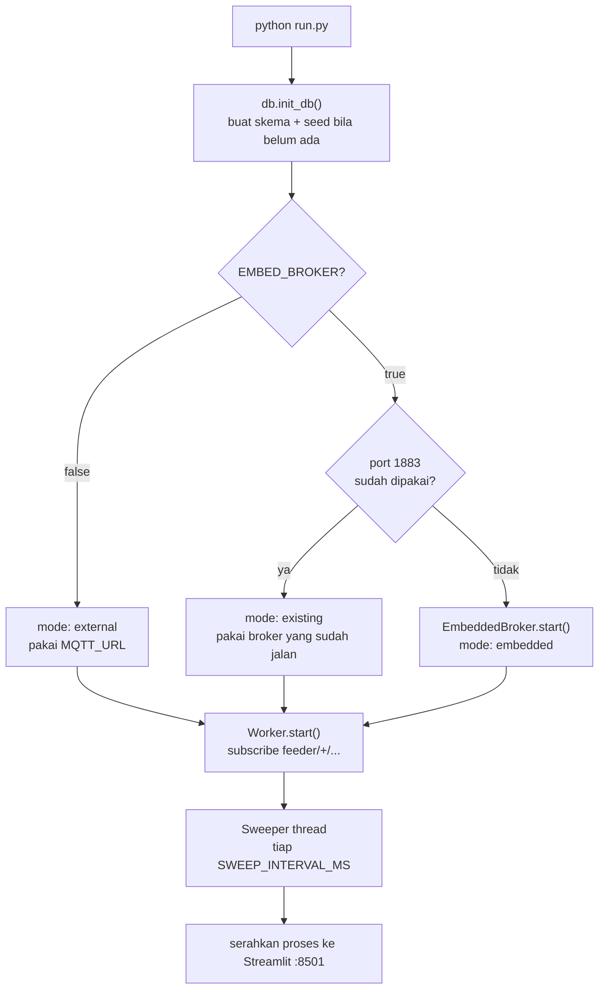

### 12.2 User Logic — Kerangka Utama (Web UI)
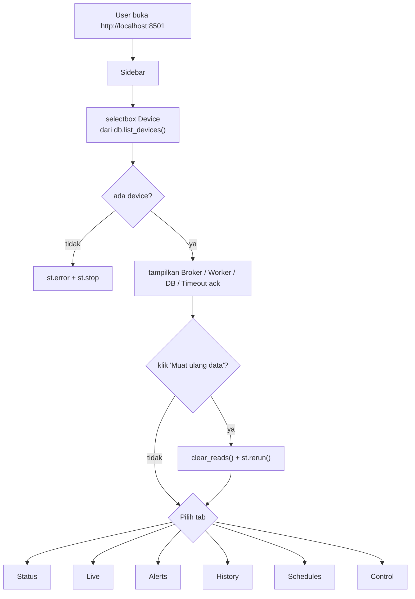

### 12.3 Hardware / Device (ESP32 `loop()` & `sim.js`)
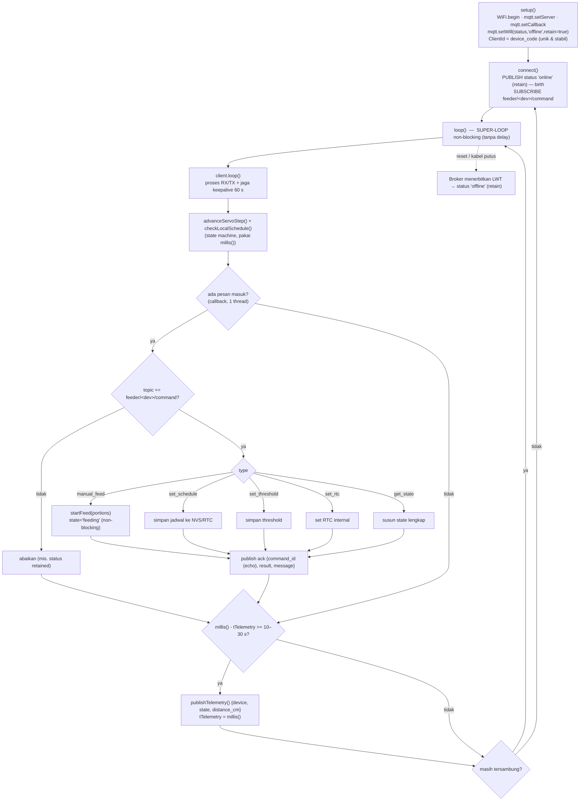

> **Dirancang single-threaded (Arduino IDE, `void loop()`).** ESP32 memang dual-core + FreeRTOS dan core Arduino sudah menjalankan task latar (WiFi/lwIP/TCP), tetapi sketch-nya cukup satu **super-loop**: tidak ada `xTaskCreate`, tidak ada thread buatan sendiri. Syarat: jangan `delay()` di jalur utama; pakai MQTT client sinkron (`PubSubClient`/`arduino-mqtt`); panggil `client.loop()` sesering mungkin; gerak servo sebagai state machine (satu langkah per `loop()`).
>
> **Selisih `sim.js` vs target firmware:** `sim.js` hanya menangani `manual_feed` (ACK `ok`, level −2 per porsi) dan `ping`. `set_schedule` / `set_threshold` / `set_rtc` / `get_state` **tidak di-ACK** oleh `sim.js` → akan `timeout` di platform. Firmware ESP32 wajib meng-ACK semua tipe (lihat §10.5).

**Kerangka firmware (ilustratif — bukan kode final):**
```cpp
#include <WiFi.h>
#include <PubSubClient.h>

const char* DEVICE_ID     = "feeder01";
const char* TOPIC_TELEM   = "feeder/feeder01/telemetry";
const char* TOPIC_CMD     = "feeder/feeder01/command";
const char* TOPIC_ACK     = "feeder/feeder01/ack";
const char* TOPIC_STATUS  = "feeder/feeder01/status";
const unsigned long TELEMETRY_MS = 15000;      // 10-30 s

WiFiClient net;
PubSubClient mqtt(net);
unsigned long tTelemetry = 0;
bool servoBusy = false;                        // state='feeding' saat true

void connectMqtt() {
  mqtt.setServer(BROKER_IP, 1883);
  mqtt.setCallback(onMessage);                 // dijalankan di dalam mqtt.loop()
  if (mqtt.connect(DEVICE_ID, nullptr, nullptr,
                   TOPIC_STATUS, 1, true, "offline")) {   // LWT
    mqtt.publish(TOPIC_STATUS, "online", true);           // birth
    mqtt.subscribe(TOPIC_CMD);
  }
}

// callback sinkron = satu thread dengan loop()
void onMessage(char* topic, byte* payload, unsigned int len) {
  if (strcmp(topic, TOPIC_CMD) != 0) return;   // abaikan pesan non-command
  // parse JSON -> command_id, type, payload
  const char* result = "ok";
  if      (strcmp(type, "manual_feed")   == 0) startFeed(portions);   // set servoBusy, bukan delay()
  else if (strcmp(type, "set_schedule")  == 0) saveSchedules(payload);
  else if (strcmp(type, "set_threshold") == 0) saveThreshold(payload);
  else if (strcmp(type, "set_rtc")       == 0) setRtc(payload);
  // ACK untuk SEMUA tipe (sukses maupun gagal)
  char ack[192];
  snprintf(ack, sizeof(ack),
           "{\"command_id\":\"%s\",\"result\":\"%s\",\"message\":\"%s\"}",
           command_id, result, msg);
  mqtt.publish(TOPIC_ACK, ack);
}

void loop() {
  if (!mqtt.connected()) connectMqtt();   // reconnect + publish birth lagi
  mqtt.loop();                            // RX/TX + keepalive
  advanceServoStep();                     // non-blocking
  checkLocalSchedule();                   // non-blocking (millis())
  if (millis() - tTelemetry >= TELEMETRY_MS) {
    tTelemetry = millis();
    publishTelemetry();                   // {device, state, distance_cm}
  }
}
```

### 12.4 Broker MQTT (`broker.py` — amqtt tertanam, atau mosquitto eksternal)
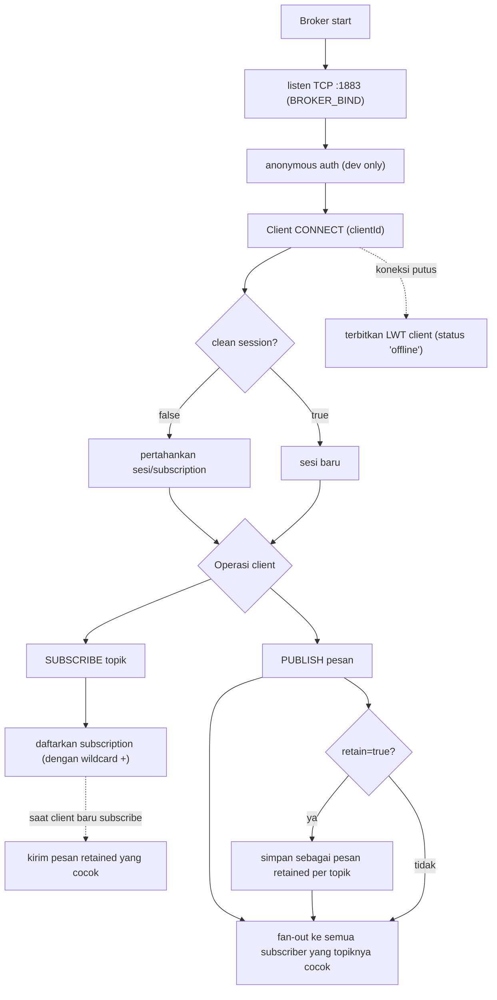

### 12.5 Platform Worker / Ingest (`mqtt.py` + `handlers.py`)
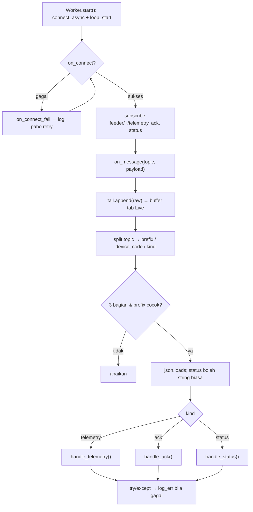

### 12.6 Database SQLite (`db.py`)
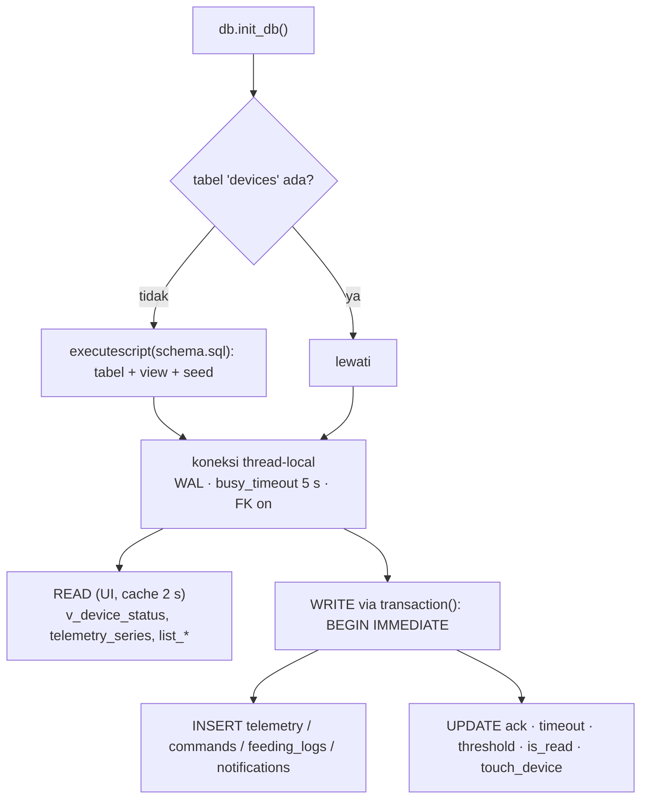

### 12.7 Web UI — Streamlit (`app.py`)
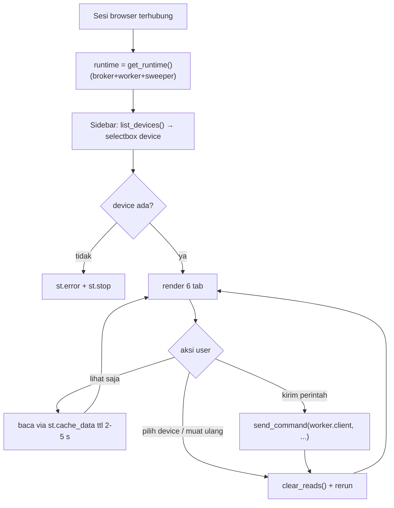

### 12.8 CLI (`cli.py`)
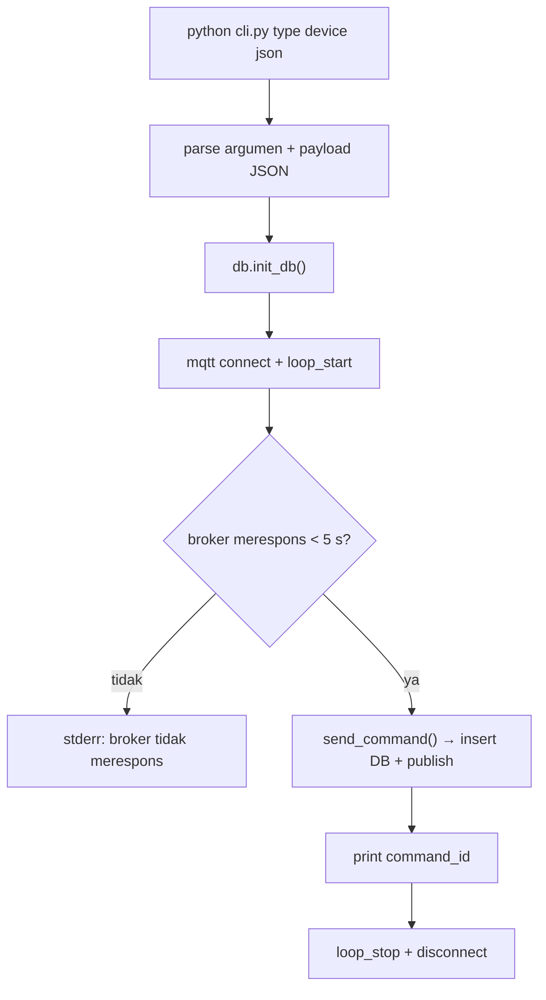

### 12.9 Node-RED (legacy, opsional)
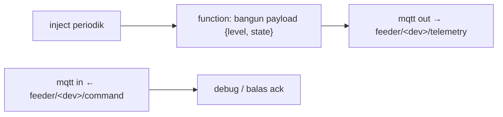

### 12.10 Siklus Hidup Perintah (outbound → ack / timeout)
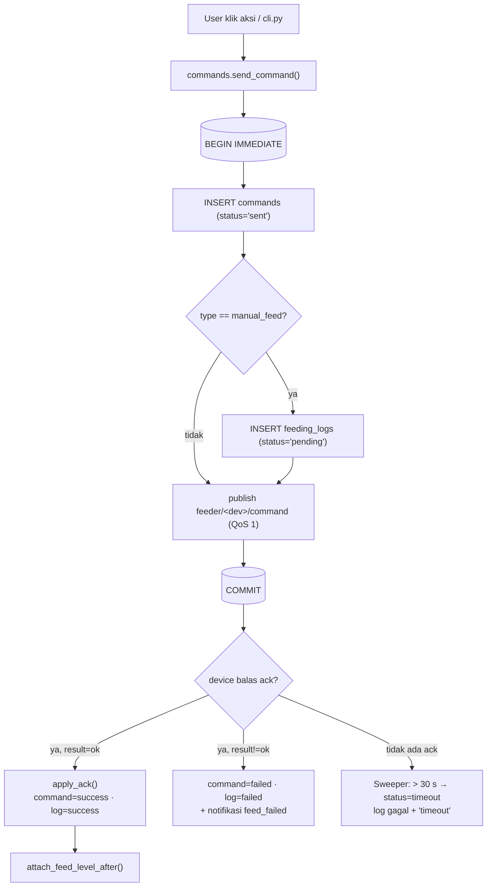

### 12.11 Ingest Telemetry & Logika Alert (`handlers.py`)
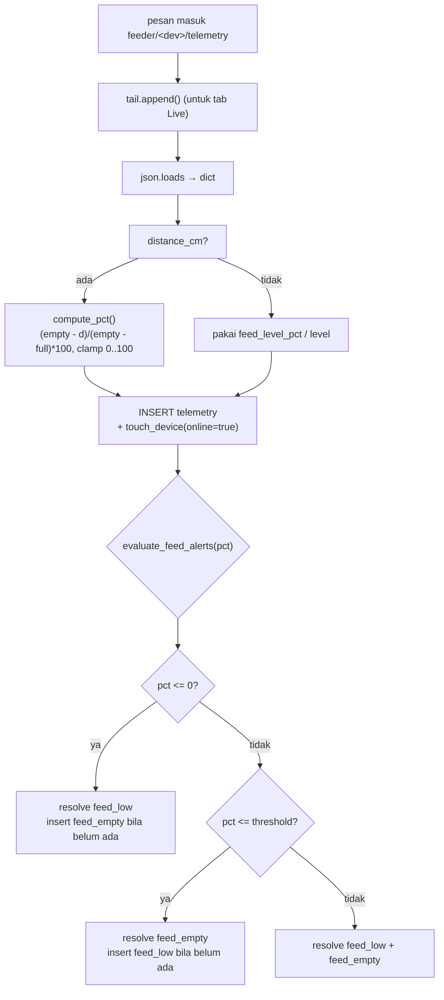

---

## 13. SKENARIO (Web → MQTT → DB)

### 13.1 Startup & Telemetry + Alert
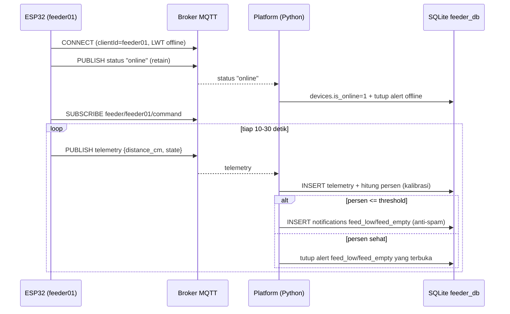

### 13.2 Manual Feed (sukses)
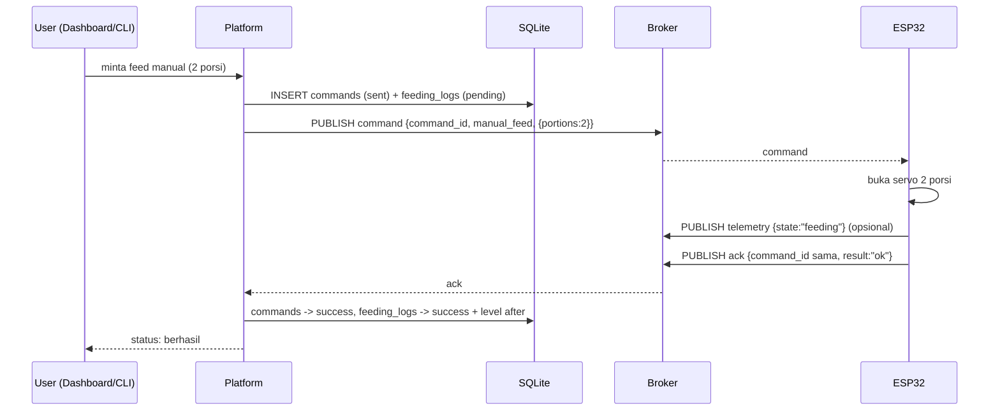

### 13.3 Gagal / Timeout / Device Mati
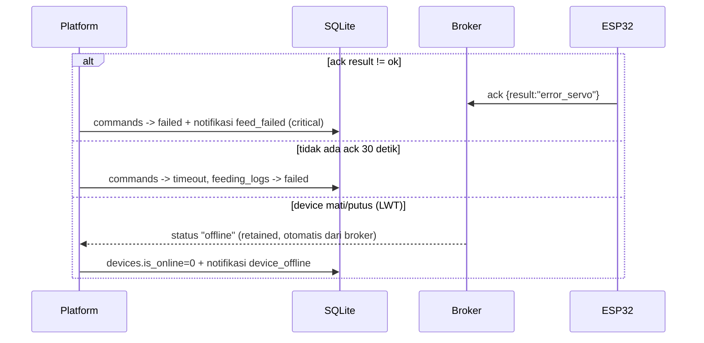

### 13.4 Skenario per Fitur (S1–S17)

**S1. Buka dashboard & pilih device (read-only)**
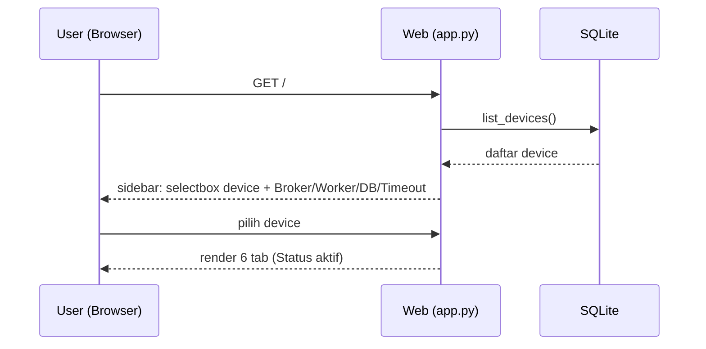

**S2. Monitor Status (auto-refresh 2 s)**
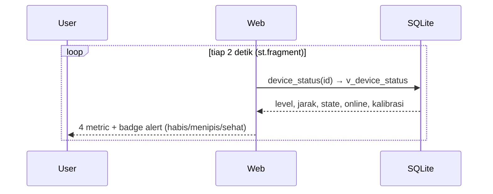

**S3. Monitor Live (grafik + pesan MQTT)**
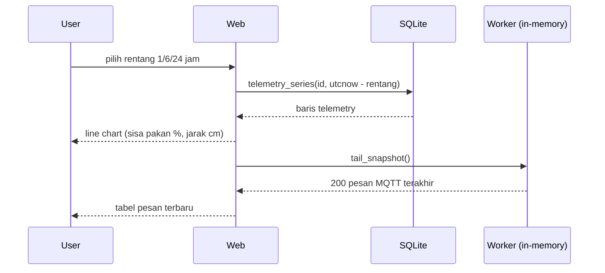

**S4. Alerts — baca / tandai dibaca**
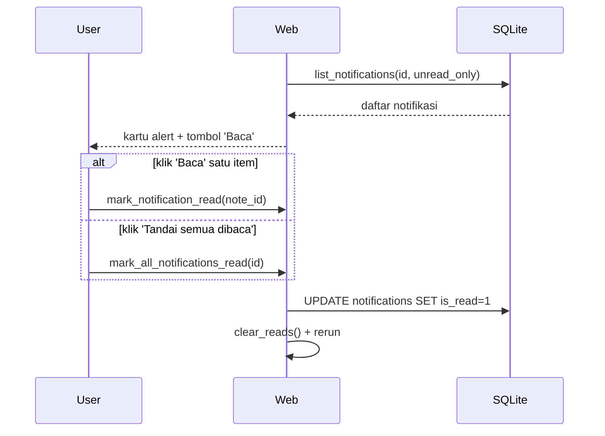

**S5. History pemberian pakan**
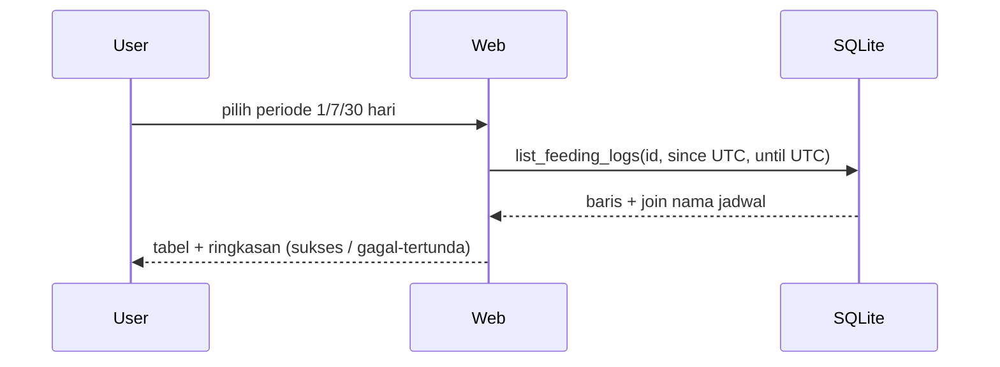

**S6. Schedules — tambah & aktif/nonaktif (lokal, tanpa device)**
```mermaid
sequenceDiagram
    participant U as User
    participant W as Web
    participant DB as SQLite
    alt tambah jadwal
        U->>W: submit form (nama, jam, porsi)
        W->>DB: insert_schedule(id, ...)
    else toggle
        U->>W: klik Aktif/Nonaktif
        W->>DB: set_schedule_active(schedule_id, not is_active)
    end
    W->>W: clear_reads() + rerun
    W-->>U: tabel jadwal ter-update
```

**S7. Schedules — kirim `set_schedule` ke device**
```mermaid
sequenceDiagram
    participant U as User
    participant W as Web
    participant DB as SQLite
    participant B as Broker
    participant D as Device
    U->>W: klik 'Kirim jadwal aktif ke device'
    W->>DB: active_schedules(id)
    DB-->>W: jadwal aktif
    W->>B: PUBLISH command set_schedule {schedules}
    Note over W,DB: send_command() lebih dulu INSERT commands(sent)
    B-->>D: command
    D->>B: ACK {command_id, result}
    B-->>W: ack
    W->>DB: commands → success/failed
    W-->>U: command_id
```

**S8. Control — Pakan manual (sukses)**
```mermaid
sequenceDiagram
    participant U as User
    participant W as Web
    participant DB as SQLite
    participant B as Broker
    participant D as Device
    U->>W: klik 'Beri pakan sekarang' (portions)
    W->>DB: BEGIN IMMEDIATE: INSERT commands(sent) + feeding_logs(pending)
    W->>B: PUBLISH manual_feed {command_id, portions}
    B-->>D: command
    D->>D: servo × portions
    D->>B: ACK {command_id sama, result:'ok'}
    B-->>W: ack
    W->>DB: commands=success, feeding_logs=success + feed_level_after
    W-->>U: sukses (menunggu ack terpenuhi)
```

**S9. Control — Pakan manual (gagal / ack error)**
```mermaid
sequenceDiagram
    participant W as Web/Platform
    participant DB as SQLite
    participant B as Broker
    participant D as Device
    D->>B: ACK {command_id, result:'error_servo'}
    B-->>W: ack
    W->>DB: commands=failed, feeding_logs=failed
    W->>DB: INSERT notifications (feed_failed, critical)
```

**S10. Control — Pakan manual (tidak ada ack → timeout)**
```mermaid
sequenceDiagram
    participant W as Web/Platform
    participant DB as SQLite
    participant SW as Sweeper (10 s)
    Note over W,DB: command tersimpan status 'sent'
    SW->>DB: tiap 10 s cek created_at < now - 30 s
    DB-->>SW: 1 command stale
    SW->>DB: commands=timeout, feeding_logs=failed 'timeout'
```

**S11. Control — `set_threshold`**
```mermaid
sequenceDiagram
    participant U as User
    participant W as Web
    participant DB as SQLite
    participant B as Broker
    participant D as Device
    U->>W: ubah threshold + klik set_threshold
    W->>DB: set_low_feed_threshold(id, pct)
    W->>B: PUBLISH set_threshold {threshold_pct}
    B-->>D: command
    D->>B: ACK {command_id, result}
    B-->>W: ack
    W->>DB: commands → success/failed
```

**S12. Control — `get_state`**
```mermaid
sequenceDiagram
    participant W as Web
    participant DB as SQLite
    participant B as Broker
    participant D as Device
    W->>DB: INSERT commands(get_state, sent)
    W->>B: PUBLISH get_state {}
    B-->>D: command
    D->>B: ACK {command_id, result:'ok', message:state lengkap}
    B-->>W: ack
    W->>DB: commands=success
```

**S13. Control — `set_rtc`**
```mermaid
sequenceDiagram
    participant U as User
    participant W as Web
    participant DB as SQLite
    participant B as Broker
    participant D as Device
    U->>W: pilih tanggal + jam → set_rtc
    W->>DB: INSERT commands(set_rtc)
    W->>B: PUBLISH set_rtc {datetime}
    B-->>D: command
    D->>D: set RTC internal
    D->>B: ACK
    B-->>W: ack
    W->>DB: commands=success
```

**S14. Device online (birth)**
```mermaid
sequenceDiagram
    participant D as Device
    participant B as Broker
    participant W as Worker
    participant DB as SQLite
    D->>B: CONNECT + PUBLISH status 'online' (retain)
    B-->>W: status 'online'
    W->>DB: ensure_device() + touch_device(online=1)
    W->>DB: resolve_notifications(['device_offline'])
```

**S15. Device offline (LWT)**
```mermaid
sequenceDiagram
    participant D as Device
    participant B as Broker
    participant W as Worker
    participant DB as SQLite
    D--xB: koneksi putus
    B-->>W: status 'offline' (LWT, retain)
    W->>DB: touch_device(online=0)
    W->>DB: INSERT notifications (device_offline) bila belum ada
```

**S16. Telemetry — alert level menipis / habis**
```mermaid
sequenceDiagram
    participant D as Device
    participant B as Broker
    participant W as Worker
    participant DB as SQLite
    participant U as User
    D->>B: PUBLISH telemetry {distance_cm}
    B-->>W: telemetry
    W->>DB: INSERT telemetry (+ hitung % dari kalibrasi)
    alt pct <= 0
        W->>DB: resolve feed_low; INSERT feed_empty (bila belum ada)
    else pct <= threshold
        W->>DB: resolve feed_empty; INSERT feed_low (bila belum ada)
    else pct sehat
        W->>DB: resolve feed_low + feed_empty
    end
    Note over U,DB: User melihat hasilnya di tab Status/Alerts
```

**S17. Muat ulang data (clear cache)**
```mermaid
sequenceDiagram
    participant U as User
    participant W as Web
    U->>W: klik 'Muat ulang data'
    W->>W: clear_reads() (kosongkan st.cache_data)
    W->>W: st.rerun()
    W-->>U: data terbaru dari DB (worker sudah menulis di belakang)
```

### 13.5 Matriks Skenario → Instance
| Skenario | Web | MQTT | DB | Hardware |
|---|---|---|---|---|
| S1 Buka & pilih device | ✅ | – | ✅ | – |
| S2 Status | ✅ | – | ✅ | – |
| S3 Live | ✅ | ✅ (tail) | ✅ | – |
| S4 Alerts | ✅ | – | ✅ | – |
| S5 History | ✅ | – | ✅ | – |
| S6 Jadwal (lokal) | ✅ | – | ✅ | – |
| S7 set_schedule | ✅ | ✅ | ✅ | ✅ |
| S8 manual_feed sukses | ✅ | ✅ | ✅ | ✅ |
| S9 manual_feed gagal | ✅ | ✅ | ✅ | ✅ |
| S10 timeout | ✅ | ✅ | ✅ | ✅ |
| S11 set_threshold | ✅ | ✅ | ✅ | ✅ |
| S12 get_state | ✅ | ✅ | ✅ | ✅ |
| S13 set_rtc | ✅ | ✅ | ✅ | ✅ |
| S14 device online | ✅* | ✅ | ✅ | ✅ |
| S15 device offline | ✅* | ✅ | ✅ | ✅ |
| S16 telemetry alert | ✅* | ✅ | ✅ | ✅ |
| S17 muat ulang | ✅ | – | ✅ | – |

\* Terlihat oleh user melalui tab Status / Live / Alerts (bukan aksi langsung).

---

# BAGIAN D — TRACEABILITY & TESTING

## 14. KRITERIA PENERIMAAN (ACCEPTANCE CRITERIA)
| Req | Kriteria penerimaan | Metode uji |
|---|---|---|
| FR-01 | Grafik menampilkan titik telemetry untuk rentang 1/6/24 jam | Visual + hitung jumlah titik (S3) |
| FR-02 | 4 metric (level, jarak, state, online) + badge alert tampil & ter-refresh ≤ 2 s | Visual, ukur interval refresh (S2) |
| FR-03 | Klik feed → device menerima `manual_feed`, ack `ok` → status `success`; gagal/timeout tercatat | S8 / S9 / S10 |
| FR-04 | Klik `get_state` → ack berisi state lengkap → command `success` | S12 |
| FR-05 | Jadwal tersimpan di DB & terkirim via `set_schedule`; aktif/nonaktif bekerja | S6 / S7 |
| FR-06 | Threshold berubah di DB & device menerima `set_threshold` | S11 |
| FR-07 | Keempat tipe notifikasi muncul; anti-spam (tidak berulang tiap telemetry); bisa ditandai dibaca | S4 / S16 / S15 |
| FR-08 | Tabel riwayat + ringkasan sukses/gagal tampil untuk 1/7/30 hari | S5 |
| NFR-01 | Tidak ada pesan hilang pada rantai device→MQTT→DB→Web | Uji transmisi berulang (S14–S16) |
| NFR-02 | Round-trip manual feed ≤ 2 s; command tanpa ack → `timeout` pada 30 s | Ukur waktu (S8 / S10) |
| NFR-03 | Deviasi persen sisa pakan ≤ 5% vs pengukuran manual | Bandingkan nilai (S16) |
| NFR-04 | Eksekusi jadwal menyimpang ≤ 60 s dari jam terjadwal | Catat waktu eksekusi device (firmware) |
| NFR-05 | Broker berjalan tanpa auth/TLS; hanya di jaringan lokal | Konfigurasi (A2) |
| NFR-06 | Sistem valid untuk 1 device `feeder01` | Konfigurasi (A4) |

## 15. MATRIKS TRACEABILITY
| Req | Fitur / Kebutuhan | Skenario | Implementasi (berkas) | Dokumen sumber |
|---|---|---|---|---|
| FR-01 | Grafik sensor periodik | S3 | `app.py::render_live`, `db.py::telemetry_series`, `handlers.py` | DASHBOARD_FLOWCHART §5 |
| FR-02 | Data terakhir + badge | S2 | `app.py::render_status`, `database/schema.sql::v_device_status` | DASHBOARD_FLOWCHART §4 |
| FR-03 | Pakan manual | S8–S10 | `app.py::render_control`, `commands.py::send_command/apply_ack`, `handlers.py::handle_ack`, sweeper `runtime.py` | DEVICE_PROTOCOL §3/§5.2–5.3 |
| FR-04 | get_state | S12 | `app.py::render_control`, `commands.py` | DEVICE_PROTOCOL §3 |
| FR-05 | Schedules | S6 / S7 | `app.py::render_schedules`, `db.py::insert_schedule/set_schedule_active/active_schedules` | DASHBOARD_FLOWCHART §8 |
| FR-06 | Threshold | S11 | `app.py::render_control`, `db.py::set_low_feed_threshold`, `commands.py` | DASHBOARD_FLOWCHART §9 |
| FR-07 | Alerts/notifikasi | S4 / S9 / S15 / S16 | `app.py::render_alerts`, `handlers.py`, `db.py` (notifications) | DATABASE_PLAN §3.6 |
| FR-08 | History | S5 | `app.py::render_history`, `db.py::list_feeding_logs` | DASHBOARD_FLOWCHART §7 |
| NFR-01 | Keandalan | S14–S16 | `mqtt.py`, `handlers.py`, `db.py` | — |
| NFR-02 | Latensi & timeout | S8 / S10 | `runtime.py` (sweeper), `config.COMMAND_TIMEOUT_SEC` | DATABASE_PLAN §7 |
| NFR-03 | Akurasi sensor | S16 | `handlers.py::compute_pct`, `devices.sensor_full_cm/empty_cm` | DATABASE_PLAN §2 |
| NFR-04 | Akurasi penjadwalan | — | firmware `checkLocalSchedule()` | FLOWCHART_PER_INSTANCE A1 |
| NFR-05 | Keamanan (constraint) | A2 | `broker.py` (anonymous) | MQTT_FOUNDATION_PLAN |
| NFR-06 | Skala (constraint) | A4 | seed `feeder01` | schema.sql §8 |

---

# BAGIAN E — PROYEK

## 16. TIMELINE & MILESTONES (Sept 2026 - Jan 2027)
- **Tahap 1 (Sept 2026) — SELESAI:** Infrastruktur Simulasi & Jaringan (Studi Literatur, MQTT Broker, integrasi MQTT ke simulator JS).
- **Tahap 2 (Okt 2026) — SEDANG BERJALAN:** Web Dashboard & Database SQLite, integrasi penuh simulator <-> MQTT <-> DB <-> Dashboard.
- **Tahap 3 (Nov 2026):** Perancangan Perangkat Keras (PCB, program ESP32, tes publish & subscribe fisik).
- **Tahap 4 (Des 2026):** Finalisasi (Perakitan fisik akuaponik, ambil data uji coba, analisis, penyusunan laporan).
- **Tahap 5 (Jan 2027):** Persiapan dan Sidang Tugas Akhir 2.

## 17. ASSUMPTIONS & DEPENDENCIES
- Broker MQTT dan SQLite berjalan di dalam satu proses Python yang sama; Mac lokal berperan sebagai host.
- Device (ESP32) dan host berada pada jaringan lokal yang sama dan stabil.
- Firmware device **wajib** meng-ACK semua tipe command (§10.5).
- Runtime: Python 3.14 + Pipenv (aplikasi), Node **v22** (`sim.js`).
- `sim.js` saat ini hanya meng-ACK `manual_feed` (+ `ping`); tipe lain akan `timeout` sampai firmware ESP32 menggantikannya.

## 18. RISKS & MITIGATIONS
| Risiko | Mitigasi |
|---|---|
| Port 1883 sudah dipakai mosquitto | Aplikasi mendeteksi dan memakai broker yang sudah jalan (mode `existing`). |
| Pesan *retained* (`status`) terkirim ke subscriber tanpa memedulikan filter topik | Firmware wajib mengabaikan pesan yang topiknya bukan `feeder/<device>/command`. |
| `clientId` duplikat → sesi saling tendang | Gunakan clientId unik & stabil (`feeder01`); jangan jalankan dua proses dengan id sama. |
| `sim.js` tidak meng-ACK `set_schedule`/`set_threshold`/`set_rtc`/`get_state` | Diketahui & didokumentasikan; firmware ESP32 harus meng-ACK semua tipe. |
| Ketergantungan instalasi eksternal (brew/mosquitto) pernah terblokir | Broker tertanam (amqtt) menghilangkan ketergantungan pada service eksternal. |
| Kehilangan data saat reset | Data uji dapat dibuat ulang dari seed `database/schema.sql`. |

## 19. OPERASIONAL (STARTUP, VERIFIKASI, CHEATSHEET)

### 19.1 Yang perlu jalan
Hanya **dua** hal: (1) aplikasi platform — broker MQTT + SQLite + dashboard, satu proses Python (`dashboard/run.py`); (2) simulator device (`sim.js`). Tidak ada mosquitto/MySQL/service yang perlu di-start lebih dulu.

### 19.2 Start (2 terminal)
```bash
# Terminal 1 — platform
cd /Users/macbookpro/Documents/TA-UPH/dashboard
pipenv install          # hanya pertama kali / setelah Pipfile berubah
pipenv shell
python run.py           # -> http://localhost:8501

# Terminal 2 — simulator (butuh Node v22)
nvm use 22
node /Users/macbookpro/Documents/TA-UPH/sim.js
```

Log yang diharapkan saat start:
```
[feeder] broker tertanam berjalan di 0.0.0.0:1883
[feeder] worker terhubung & subscribe: feeder/+/telemetry  feeder/+/ack  feeder/+/status
[feeder] runtime siap — broker: embedded (0.0.0.0:1883), db: .../dashboard/feeder.db
[feeder] platform siap — broker: embedded (0.0.0.0:1883)
```

### 19.3 Verifikasi
Buka dashboard -> tab **Status** (sisa pakan bergerak tiap 3 detik) dan **Live**. Atau lewat CLI:
```bash
cd /Users/macbookpro/Documents/TA-UPH
sqlite3 -header -column dashboard/feeder.db "SELECT * FROM v_device_status;"

cd dashboard
pipenv run python cli.py manual_feed feeder01 '{"portions":2}'
```

### 19.4 Command CLI lain
```bash
pipenv run python cli.py get_state feeder01
pipenv run python cli.py set_threshold feeder01 '{"threshold_pct":25}'
```

### 19.5 Inspeksi DB langsung (tanpa server)
```bash
sqlite3 dashboard/feeder.db "SELECT * FROM v_device_status;"
sqlite3 -header -column dashboard/feeder.db \
  "SELECT type, severity, message, created_at FROM notifications ORDER BY created_at DESC LIMIT 5;"
sqlite3 -header -column dashboard/feeder.db \
  "SELECT requested_at, trigger_type, portions, status, message FROM feeding_logs ORDER BY requested_at DESC LIMIT 10;"
sqlite3 -header -column dashboard/feeder.db \
  "SELECT name, feed_time, portions, is_active FROM schedules WHERE is_active = 1 ORDER BY feed_time;"
```

### 19.6 Live-stream transaksi MQTT (`mosquitto_sub`)
```bash
mosquitto_sub -h localhost -t 'feeder/#' -F '%I %t | %p'
mosquitto_sub -h localhost -t 'feeder/+/telemetry' -F '%I %t | %p'
mosquitto_sub -h localhost -t 'feeder/+/command' -F '%I %t | %p'
mosquitto_sub -h localhost -t 'feeder/#' -F '%I %t | %p' | tee mqtt.log
```
Catatan: `-F` mendukung `%I %U %t %p %j %q %r %l` (bukan `%H/%M/%S`); `-R` melewati pesan retained; broker tertanam (amqtt) tidak menulis log per-paket. Alternatif GUI: MQTT Explorer / MQTTX. Dashboard juga punya tail sendiri: tab **Live → "Pesan MQTT terbaru"** (200 pesan terakhir, in-memory).

### 19.7 Konfigurasi umum
| Kegiatan | Perintah |
|---|---|
| Ubah threshold alert | `sqlite3 dashboard/feeder.db "UPDATE devices SET low_feed_threshold_pct = 25 WHERE device_code = 'feeder01';"` |
| Kalibrasi sensor | `sqlite3 dashboard/feeder.db "UPDATE devices SET sensor_full_cm = 5.00, sensor_empty_cm = 30.00 WHERE device_code = 'feeder01';"` |
| Tambah jadwal | `sqlite3 dashboard/feeder.db "INSERT INTO schedules (device_id, name, feed_time, portions) SELECT id, 'Pakan Malam', '21:00:00', 1 FROM devices WHERE device_code = 'feeder01';"` |
| Ubah port / broker eksternal | `dashboard/.env` → `EMBED_BROKER`, `BROKER_BIND`, `MQTT_URL` |

### 19.8 Shut down & reset
`Ctrl+C` di kedua terminal (tidak ada service yang perlu dimatikan). Reset total data uji:
```bash
rm -f dashboard/feeder.db dashboard/feeder.db-wal dashboard/feeder.db-shm
# start ulang: skema + seed dibuat otomatis dari database/schema.sql
```

### 19.9 Troubleshooting
| Symptom | Fix |
|---|---|
| `pipenv: command not found` | `pip3 install --user pipenv` |
| Dashboard "terputus" | Broker tidak jalan; cek log terminal 1 / pastikan port 1883 tidak dipakai proses lain |
| `port 1883 sudah terpakai` | Ada mosquitto/broker lain — aplikasi memakainya (tidak masalah); untuk mode tertanam: `brew services stop mosquitto` |
| `sim.js` crash `Cannot find module ...mqtt` | Node versi salah; `nvm use 22` |
| `nvm: command not found` | Buka terminal baru / `source ~/.nvm/nvm.sh` |
| Data lama/aneh | Reset: `rm -f dashboard/feeder.db*` lalu start ulang |
| Perintah nyangkut `sent` | Device tidak membalas; setelah 30 s ditandai `timeout` (sweep tiap 10 s) |

### 19.10 Menjaga broker tertanam sebagai default (mosquitto dimatikan)
Tujuan: aplikasi **selalu** menjalankan **broker tertanam (amqtt)** di dalam proses Streamlit,
bukan memakai mosquitto yang mungkin terpasang di mesin. Kuncinya: port `1883` harus kosong saat
`python run.py` dijalankan (lihat logika pemilihan broker di §12.1).

Mosquitto dari Homebrew berjalan sebagai service yang auto-start saat login. Matikan sekaligus
lepaskan dari startup:

```bash
brew services stop mosquitto        # stop + unregister dari startup (tak kembali saat reboot/login)
brew services list | grep mosquitto # harus menampilkan status "none"
lsof -nP -iTCP:1883 -sTCP:LISTEN    # harus kosong
```

Setelah itu `python run.py` akan menulis:

```
[feeder] broker tertanam berjalan di 0.0.0.0:1883
[feeder] runtime siap — broker: embedded (0.0.0.0:1883), ...   # bukan "port 1883 sudah terpakai"
```

Catatan:
- Mosquitto **tetap terpasang** — `mosquitto_sub` / `mosquitto_pub` masih bisa dipakai sebagai
  klien untuk debug ke broker tertanam (lihat §19.6). Untuk melepas sepenuhnya:
  `brew uninstall mosquitto` (kehilangan CLI debug tersebut).
- Mengembalikan ke broker eksternal: `brew services start mosquitto` (aplikasi lalu mendeteksi
  port terpakai dan memakai broker itu, mode `existing`).
- Verifikasi proses: `lsof -nP -iTCP:1883 -sTCP:LISTEN` harus menunjuk ke proses **Python**,
  bukan `mosquitto`.

## 20. GLOSSARY
| Istilah | Arti |
|---|---|
| **MQTT** | Protokol messaging publish/subscribe yang dipakai device ↔ platform. |
| **Broker** | Server MQTT yang meneruskan pesan antar client (amqtt tertanam / Mosquitto). |
| **Retained** | Pesan terakhir yang disimpan broker dan langsung dikirim ke subscriber baru. |
| **LWT** | *Last Will and Testament* — pesan `offline` yang dipublish broker otomatis saat device mati. |
| **command_id** | ID unik command, di-echo di ack untuk korelasi. |
| **ack** | Balasan device atas sebuah command (sukses/gagal). |
| **Telemetry** | Data berkala dari device (jarak sensor, state). |
| **State** | Snapshot kondisi lengkap device (jadwal, RTC, level pakan) dari topik `state`. |
| **Portion** | Satuan porsi pakan yang diberikan servo. |
| **Hopper** | Wadah/penampung pakan yang diukur levelnya oleh sensor ultrasonik. |
| **Kalibrasi full/empty** | Jarak sensor saat hopper penuh dan kosong, untuk konversi jarak ke persen. |
| **WAL** | *Write-Ahead Logging* — mode SQLite yang mengizinkan baca & tulis bersamaan. |
| **Sweeper** | Thread berkala (10 s) yang menandai command tanpa ack sebagai `timeout`. |
